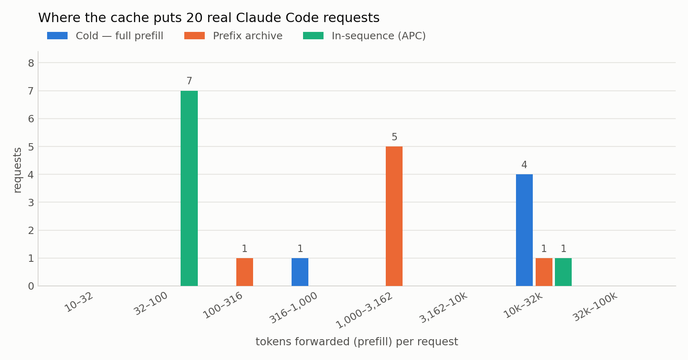
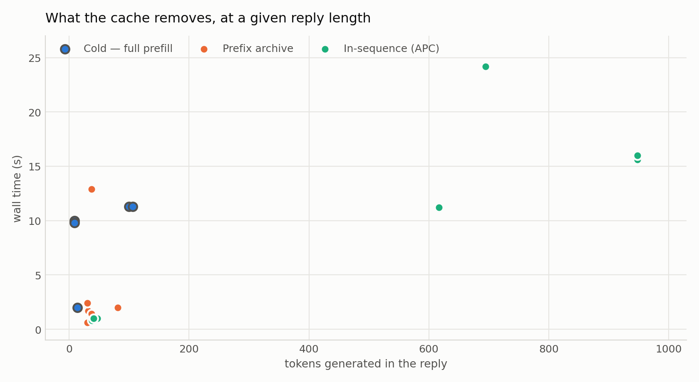
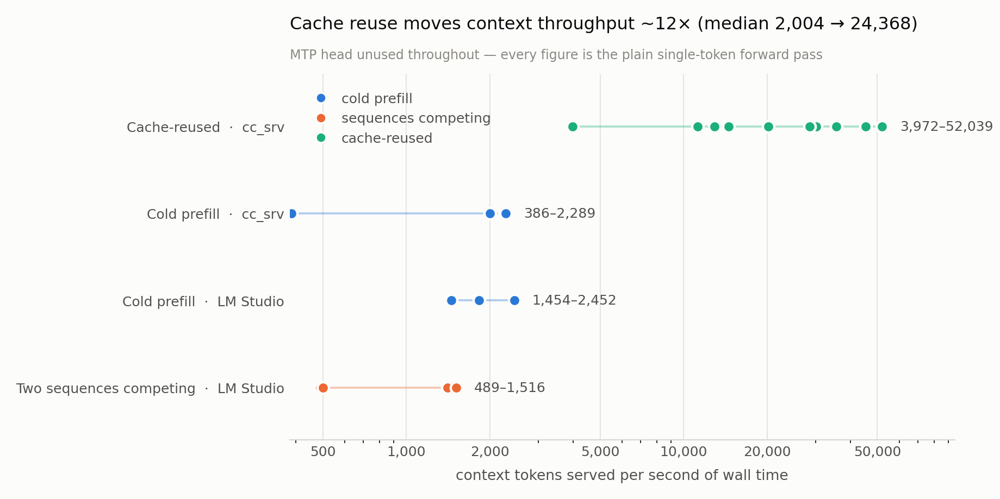

# cc_srv

An Anthropic-Messages backend for llama.cpp. Claude Code talks to it instead of a
hosted provider, and a local model becomes the agent.

The design uses one property of agentic sessions: each request's prompt is the
previous prompt plus a few tokens. Four cache layers exploit it, cheapest first.

Measured on one real session of 20 requests, RTX 5060 Ti: **15 hit a cache layer,
and 447,657 of the 591,946 prompt tokens (75.6%) were never forwarded to the
model.** Configuration was `CC_ARCHIVE=1 CC_BATCH=1 CC_BATCH_N=3` — 4 sequences,
`n_ctx` 524288. The draft cache is off by default, so speculative decoding was
off for every measurement in this section.

---

## Quick start

**Edit `lib.py` first.** `DLL` is the directory holding your llama.cpp shared
libraries, `GGUF` your chat model. Both point at the machine this was developed
on.

```powershell
$env:CC_ARCHIVE='1'   
$env:CC_BATCH='1'; $env:CC_BATCH_N='3'
python run.py --port 8788 --n-ctx 131072
curl.exe http://127.0.0.1:8788/health     # {"ok": true}
```

```powershell
claude --settings D:/path/to/cc_srv/_cc_local.json
```

`--settings` is required, not stylistic: a settings file's `env` block outranks
the process environment in Claude Code 2.1.270, so `$env:ANTHROPIC_BASE_URL=...;
claude` keeps talking to whatever `~/.claude/settings.json` already points at.

**Edit the `UserPromptSubmit` command in `_cc_local.json` too.** It holds an
absolute path to this machine's Python and to `cc_hook.py`. A stale path makes
the hook fail on every prompt you type; delete the `hooks` block if you don't
want prompt capture.

Requests land in `logs/server.log`:

```
2026-09-13 20:22:53 [INFO ] [req] req 52039+41 batch_apc pre=77 reuse=51962 p_raw=- cur=52079 1.0s (prefill 0.0s + decode 0.0s) turn=text:e24e0fc8 seq=0
```

A 52,039-token prompt, 51,962 of it served from cache, 77 forwarded, 1.0 s. The
prefill/decode split reads zero on the batched path; only the total is real.

While a prompt is being forwarded, each request reports its own progress:

```
2026-09-16 22:28:14 [INFO ] [cc_srv] prefill  10.0% (11763/117636 tok seq=0)
2026-09-16 22:28:15 [INFO ] [cc_srv] prefill  62.2% (73169/117636 tok seq=0)
2026-09-16 22:28:16 [INFO ] [cc_srv] prefill 100.0% (117636/117636 tok seq=0)
```

The percentage is of the tokens **this request forwards**, not of the prompt:
a request served from the cache that forwards 300 tokens of a 50k prompt reads
as nearly done, because that is the work it is actually paying for. `seq=` is
the sequence the scheduler handed the job, which is what makes concurrent
prefills readable when a fan-out interleaves them.

One line per step crossed, at most one per forward pass. `CC_PROGRESS_STEP`
sets the step; `CC_PROGRESS=0` turns it off entirely. The reason this is
computed here rather than taken from llama.cpp's own `Prompt processing
progress` is granularity: this engine forwards in chunks of at most `bs` tokens
so a long prefill can share a step with requests that are already decoding, and
the C-level message is emitted per forward pass with no idea which request it
belongs to. On the 117,636-token prompt above that is over 900 identical lines,
several of them interleaved from concurrent jobs.

---

## What the cache does to a session

Both charts are those 20 requests. Colour is the layer that served each one.



Cold requests forward the entire prompt, a median of **22,641 tokens**. Requests
the archive held a state for forward **1,232**. Requests continuing the sequence
already in the KV forward **71**.



Reply length is the part no cache touches. Plotted against it, cold requests
(ringed) sit above the cached ones at every length, and the distance is the
prefill they paid. The cached points that climb, 11 s and 24 s, are replies of
600 to 950 tokens, which no cache shortens.

At reply lengths of 30 to 106 tokens:

| served by | reply tokens | prefill forwarded | wall time |
|---|---:|---:|---:|
| cold | 100 | 22,646 | 11.3 s |
| cold | 106 | 22,641 | 11.3 s |
| prefix archive | 81 | 1,055 | 2.0 s |
| prefix archive | 32 | 2,324 | 1.7 s |
| prefix archive | 37 | 1,048 | 1.4 s |
| prefix archive | 30 | 170 | 0.6 s |
| in-sequence | 41 | 77 | 1.0 s |
| in-sequence | 41 | 66 | 0.9 s |

**81 reply tokens in 2.0 s, against 100 reply tokens in 11.3 s.** The shortest
cached replies returned in under a second.

---

## Throughput

Context tokens served per second of wall time, same formula for both sides. A
cold request's wall time is nearly all prefill and a cached request's is mostly
generation, so the cached column below is the conservative one.



| | median context tok/s |
|---|---:|
| cold prefill, `cc_srv` | 2,004 |
| cold prefill, LM Studio | 1,832 |
| two sequences competing, LM Studio | 956 |
| **cache-reused, `cc_srv`** | **24,368** |

About 12x at the median. The reused side runs from 3,972 to 52,039. The low end
is a 51,244-token prompt whose divergence point the archive didn't have, so it
forwarded 22,677 tokens anyway and still beat every cold request on the chart.
The high end reused 99.9% of its context.

Rows are the 15 session requests that generated 106 tokens or fewer, so wall time
is prefill-dominated on both sides. The 5 that generated 617 to 948 tokens are
excluded, because generation is their wall time. Six cold prefills from the
engine log, on prompts of 11,589 to 71,070 tokens, independently land between
1,846 and 2,318 tok/s.

Both caveats concern what these numbers are not:

- **Not MTP.** The model ships a multi-token prediction head and this engine
  never enables it; `mtp` in `lib.py` stays at llama.cpp's default, which is off.
  Every figure is a plain single-token forward pass.
- **Not measured against a tuned baseline.** The LM Studio rows are the same
  card and the same GGUF without the cache stack. Within them, two concurrent
  sequences nearly halve prefill throughput, 1,832 to 956 tok/s. That is why
  batching here is a latency win and not a throughput one.

---

## How it works

| layer | fires when | cost |
|---|---|---|
| **Logits cache** | the prompt is identical, token for token | no forward pass, no KV |
| **Trajectory recall** | the prompt is a prefix of a recorded trajectory | no forward pass, no KV |
| **Turn-keyed reuse** | the trailing user turn was answered before | no forward pass, no KV |
| **APC** | any common prefix | forwards only the new part |
| cold | anything else | full prefill |

The first three return tokens that nothing recomputed. APC carries most of the
saving in a long session, because a dialog's prompt is the previous prompt plus a
few tokens.

**Turn-keyed reuse.** The logits cache keys on the whole prompt, so inside a
dialog it almost never fires: every turn appends the previous exchange. Keying on
the trailing user turn instead makes a repeated question answerable. `CC_QREUSE=1`
matches the same question in the same dialog; `CC_QREUSE=2` with `CC_QEDIT=1`
also matches a merely similar question from any dialog and rewrites the old
reply. A top-k logits trace is kept behind every generated token and replayed
through argmax, so replayed tokens cost no forward pass, and each substitution
the rewrite makes is checked against the model's own cached top-k at that
position.

**Three things in a Claude Code prompt break a prefix cache.** All three are
handled:

- The prompt carries `<total_tokens>N tokens left</total_tokens>` and `N` changes
  on every request, so the prefix ends at its first occurrence. Normalized
  server-side, and `_cc_local.json` sets `CLAUDE_CODE_TOTAL_TOKENS_REMINDER=
  infinite`, which stops it changing at all.
- The assistant header used while generating must match the one used when
  re-rendering history, byte for byte. It is taken from the model's own chat
  template rather than hardcoded newlines.
- Assistant messages usually carry an empty text block. A naive join turns it
  into two extra newlines, enough on its own to zero out a thousand tokens of
  reuse. They are dropped.

### Thinking, and why `CC_THINK=0` is a lock

The model writes its reasoning inside `<think>...</think>`. By default it is
stripped before it reaches the client, but "stripped" is not the same as "off":
reasoning can be switched on from three independent places, and a setting that
closes only one of them does not do what it says.

| source | how it turns reasoning on | closed by `CC_THINK=0` |
|---|---|---|
| the live switch | `GET /think?on=1` | yes — the request is **refused**, not obeyed |
| the client | an Anthropic `thinking` field in the request, which Claude Code sends | yes |
| the history | thinking blocks already in the transcript, re-rendered into the prompt as `<think>...</think>` | yes — the reasoning body is dropped, the token cost with it |

The third one is the easy one to miss, and the one that matters most: re-sending
a transcript's reasoning is itself an instruction to keep reasoning, so a server
that stripped only the *output* would still be asking the model to think on every
turn after a thinking turn.

So `CC_THINK=0` is read once at startup as a hard lock. With it set,
`want_think()` returns `False` unconditionally, `/think?on=1` answers
`{"think": false, "locked": true}` instead of switching anything, and history is
rendered with its reasoning stripped — as the plain closed empty block
`<think>\n\n</think>\n\n`, which is also the shape the non-thinking path uses, so
the prefix stays stable. Restarting with `CC_THINK=1` is the only way back on; a
lock a runtime call can undo is not a lock.

Note the asymmetry this leaves in place. A closed empty block still tells the
model *"your reasoning is already finished"* rather than telling it not to
reason, because that is the header the re-rendered history is matched against
byte for byte. `CC_THINK=0` guarantees no reasoning reaches the client and no
recorded reasoning re-enters the prompt; it is not a claim about what the model
does internally.

Switching the setting changes the prompt header, so the prefix changes with it
and the next request pays one cold prefill. That is inherent in changing what the
model is asked, not something the server can avoid. A request that asked for
thinking while the lock is set logs `locked` instead of `req`, so a refusal is
visible rather than looking like a hit.

### Beyond the prefix

**Prefix archive.** On by default (`CC_ARCHIVE=0` turns it off). Sibling
subagents share a long prefix but are not extensions of each other, so an
ordinary prefix cache cannot help them. The archive keeps whole KV states at the
points where requests actually diverge and restores one wholesale. In the session
above it served 7 of 20 requests; the clearest was a 24,775-token prompt that
forwarded **2,324** tokens, the other 22,451 already in an archived state.

**Batched serving.** A 9B Q4 decode step reads all 5.5 GB of weights whatever it
produces, so one read can advance several sequences at once. With `CC_BATCH=1`
concurrent requests share a forward pass: 3.3x the decode throughput of serving
them one at a time.

### The two batch sizes, and why they are separate knobs

`CC_N_BATCH` and `CC_N_UBATCH` default to 2048 and 512, matching LM Studio's
*evaluation batch size* and *physical batch size* for the same model on the same
card — so the two servers are a like-for-like comparison out of the box. They
were hardcoded at 512 and 128 before.

| | `CC_N_BATCH` (2048) | `CC_N_UBATCH` (512) |
|---|---|---|
| what it bounds | tokens in one `llama_decode` | tokens in one GPU forward pass |
| what it speeds up | Python-side bookkeeping | **prefill throughput** |
| VRAM cost | almost none | **linear** — the compute buffer is `n_ubatch × n_embd` |
| who else reads it | `Batch._plan` sizes each step's token budget from it | nobody |

They are not interchangeable. When `n_batch > n_ubatch`, llama.cpp splits the
logical batch into several forward passes, so raising `n_batch` alone buys
nothing but shorter bookkeeping — `n_ubatch` is the one that moves prefill
speed. It is also the one that runs the card out of memory, which at
`n_ctx` 524288 with Q4_0 KV is a real risk. `n_ubatch > n_batch` is rejected at
startup, with a message naming both settings rather than a bare assert.

One coupling was deliberately cut. The scheduler takes each prefill chunk as
`eng.bs // 4`, which was 128 while `n_batch` was 512 — but raising `n_batch` to
2048 would have made that 512, and a prefill taking 512 tokens out of a step is
exactly the shape that produced the measured **p90 of 199 s**: one arriving
prompt eating the step while the sequences already decoding got no token at all.
The chunk is now capped at 128 independently of `n_batch`, and `CC_BATCH_CHUNK`
sets it directly. The *step budget* still scales with `n_batch`, which is what
that setting should control.

**Speculative decoding.** `CC_DDC` reuses continuations the model has already
produced and verifies them in a batch. Drafts come from the context itself, so
the only cost is verification, and a round is roughly 3x faster when the draft
lands and a net loss when it doesn't. Two gates decide when it runs.

The first buckets rounds by draft length and measures each bucket against plain
decoding. In one session the 2-3 token drafts ran at 0.56x and were dropped; the
16+ token drafts ran at 3.3x and were kept.

The second asks whether the content is repeating at all. Building the draft index
costs a full-vocabulary scan per committed token, measured at **7.9% of
generation time**, and repays it only where drafts land. So DDC stands down when
the generated token stream stops repeating and resumes when it starts. Three
prompts, tokens per second:

| | diverse | diverse | repetitive |
|---|---:|---:|---:|
| `CC_DDC=0` | 69.2 | 69.8 | 69.6 |
| DDC on, gates off (`CC_SPEC_GOV=0`) | 58.1 | 59.0 | 128.8 |
| **DDC on, gates live** | **66.6** | **67.9** | **141.5** |

The 13% penalty on non-repeating content falls to 3%, and the 2.0x win on
repeating content holds.

What decides whether speculation pays is the **accept rate**, not the context
length. A round that lands its whole draft is roughly 3x faster than decoding one
token at a time; a round that lands a fraction of it pays two forward passes for
about one token. `CC_DDC_MAX_CTX` therefore defaults to the sequence's own window
and never cuts DDC off early — it survives only as the clamp that keeps a draft
from running past the end of the context.

Two things are worth knowing before turning it on:

- **It is off by default, and it runs with the archive.** The draft cache used to
  be the default layer and the archive opt-in; that is now the other way round,
  because the archive is what pays on the shape this server actually sees
  (fan-out) while speculation is a throughput knob that only pays where the
  content repeats. The two used to need the same spare sequence, which is why
  the pair was refused; the verification scratch now gets a sequence of its own
  and the archive keeps its own, so the layouts are disjoint and
  `CC_ARCHIVE=1 CC_DDC=4` — or just `CC_DDC=4`, since the archive is on anyway —
  is served. It costs one sequence on top of the archive's, and with both on,
  `n_ctx` is multiplied by workers + 1 + archive slots. A request prefills
  through the archive first and the draft cache then runs on top of whatever
  prefix that restored; that same prefill is what fills the archive.
- **The batched scheduler**, via `CC_DDC_BATCH=1`. Without it DDC runs on the
  serial path only: `CC_BATCH=1` sends every request to the scheduler, which
  never calls the serial generation path, so no speculation happens however
  `CC_DDC` is set. The engine says so at startup rather than leaving the
  counters to sit at zero.

  With it, a verification is one part of the step's batch — a forward pass is
  what the scheduler exists to share — and the draft is copied aside on a
  scratch sequence the job holds for its reply. `CC_DDC_BATCH_SCRATCH` (default
  1) bounds how many requests may speculate at once; each reserved scratch costs
  one sequence of KV, so at `n_ctx` 131072 that is 1.2 GB per scratch. A round
  that is only partly accepted is *discarded* rather than committed: committing
  it would need the accepted prefix re-decoded on the main sequence, a second
  forward pass this path does not spend. The governor is told the round returned
  nothing, so a draft length that mostly lands half-way is dropped by the same
  gate that drops any other losing bucket.

  **This path is new and has not been run.** It is off by default for that
  reason. Everything the serial path does was measured before it shipped; this
  was written against the scheduler's documented invariants and reviewed, not
  executed. Treat `ddc_dropped` and the `spec`/`full` counters as the things to
  watch first.

---

## Configuration

Everything is an environment variable.

**On by default:**

| variable | default | effect |
|---|---|---|
| `CC_ARCHIVE` | on | prefix archive. Costs a spare sequence, so `n_ctx` doubles and KV goes 1.2 to 2.4 GB at 131072. Set `CC_ARCHIVE=0` to turn it off |

**Opt-in:**

| variable | default | effect |
|---|---|---|
| `CC_DDC` | off | speculative decoding; `2` or `4` sets the draft cache key width. Costs a spare sequence on top of the archive's |
| `CC_DDC_BATCH=1` | off | let DDC speculate inside the batched scheduler instead of standing down under `CC_BATCH`. New and unrun — see the DDC section |
| `CC_QREUSE=1` | off | reuse the reply to a repeated user turn |
| `CC_BATCH=1` | off | serve concurrent requests in one batch; `CC_BATCH_N` sizes it |

**Tuning:**

| variable | default | effect |
|---|---|---|
| `CC_ARCHIVE_SLOTS` | 1 | sequences the archive keeps |
| `CC_ARCHIVE_MIN` | 512 | shortest prefix worth archiving |
| `CC_BATCH_N` | 4 | worker sequences, i.e. concurrent requests |
| `CC_BATCH_WAIT` | 512 | prefix tokens worth giving up to avoid waiting for the busiest worker |
| `CC_N_BATCH` | 2048 | logical batch: the most tokens one `llama_decode` may carry. Also sizes each scheduler step's token budget |
| `CC_N_UBATCH` | 512 | physical batch: what one GPU forward pass computes. Must be ≤ `CC_N_BATCH`. Costs VRAM linearly |
| `CC_BATCH_CHUNK` | 128 | most prompt tokens one prefill may take from a step. Deliberately not tied to `CC_N_BATCH` |
| `CC_PROGRESS` | 1 | report prefill progress; `0` turns it off |
| `CC_PROGRESS_STEP` | 10 | percent between progress lines; `0` silences it too |
| `CC_DDC_M` | 32 | draft length cap; the truncation threshold usually binds first |
| `CC_DDC_T` | 0.5 | draft truncation threshold, lower means longer drafts. At `M=32/T=0.5` drafts run 15 to 22 tokens |
| `CC_DDC_MAX_CTX` | window | length at which the draft cache stands down; defaults to the sequence's own window, `0` removes the clamp entirely |
| `CC_SPEC_GOV` | 1 | the gates; `0` speculates whenever a draft exists |
| `CC_SPEC_MIN` | 12 | rounds of evidence before a draft length is judged |
| `CC_SPEC_COOLDOWN` | 64 | rounds before a dropped draft length is re-probed; doubles each time |
| `CC_SPEC_REP_MIN` | 0.15 | repeat-rate floor, below which DDC stands down |
| `CC_SPEC_REP_GRACE` | 128 | tokens of grace before DDC may stand down |
| `CC_DDC_BATCH_SCRATCH` | 1 | scratch sequences the batched scheduler may hand out for DDC rounds. Each one lets another request speculate concurrently, and costs a sequence of KV |
| `CC_QEDIT` | off | keep the top-k trace that level-2 reuse rewrites from |
| `CC_QEDIT_SIM` | 0.9 | similarity floor for a level-2 turn |
| `CC_QREUSE_TOOL` | 0 | allow reuse of a reply to a tool result; see below |
| `CC_STREAM` | 1 | stream text while the model is still generating |
| `CC_THINK` | 0 | `0` is a **hard lock**: no reasoning this process, from any source. `1` allows it |
| `CC_PROGRESS` | 1 | report prefill progress; `0` turns it off |
| `CC_PROGRESS_STEP` | 10 | percent between progress lines; `0` silences it too |
| `CC_LOG` | `info` | `debug` / `info` / `warn` / `error` / `off` |
| `CC_LOGDIR` | `./logs` | where `server.log` and `requests.jsonl` go |

Archive and batching together:

```powershell
$env:CC_ARCHIVE='1'
$env:CC_QREUSE='1'
$env:CC_BATCH='1'; $env:CC_BATCH_N='3'
python run.py --port 8788 --n-ctx 131072
```

`n_ctx` is multiplied by the sequence count so each keeps a full window: 3
workers plus 1 archive slot is `n_ctx` x 4, or 4.8 GB of KV at 131072. Lower
`--n-ctx` if the card is tight.

### When to leave a layer off

- **Turn-keyed reuse** answers with the reply the model gave that question
  earlier. That is right when a dialog is being replayed or a question genuinely
  repeats, and it is a semantic choice rather than a correctness proof: nothing
  re-derives the reply under the context that is current now. Level 2 is the
  sharp edge. Claude Code questions share enough boilerplate that two genuinely
  different questions can score around 0.65 similarity, so a loose floor answers
  one question with a copy of the answer to another. The floor defaults to 0.9,
  and a difference admitting no substitution is refused. If you need every reply
  produced under the current context, leave `CC_QREUSE` at 0.
- **Reusing the reply to a tool result** (`CC_QREUSE_TOOL=1`) is off because such
  a reply usually contains the tool call that produced the result, so replaying
  it re-issues the call and the dialog loops.
- **Batched serving** changes the graph shape, so a reply can differ from the
  single-sequence path. About half of prompts diverge somewhere, deterministically:
  the engine's documented batch-versus-sequential numerics, not a race. Leave
  `CC_BATCH` off if replies must match the single-sequence server.
- **Speculative decoding** pays only where drafts land: repetitive code, repeated
  tool calls, re-reads of the same file. The gates turn it off elsewhere, so the
  usual reason to disable it is not speed but determinism. A speculative round
  takes a different numerical path, so `CC_DDC=0` if replies must match the plain
  single-token server bit for bit.
- **The prefix archive** is on by default and `CC_DDC` is off by default, which
  is the opposite of how they used to be. Turning DDC on costs a sequence on top
  of the archive's — the archive keeps its slots, DDC keeps its verification
  scratch, and `n_ctx` is multiplied by workers + 1 + archive slots. Neither
  setting disables the other.

---

## Files

```
run.py         entry point
srv.py         HTTP layer, Claude Code adapters, request logging
eng.py         engine: KV, APC, logits cache, recall, archive
batch.py       scheduler: many requests, one forward pass per step
qcache.py      turn-keyed reuse and the argmax logit replay
spec.py        the two gates for speculative decoding: draft length, and
               whether the content is repeating at all
ddc.py         the margin-aware draft cache
ddc_decode.py  target-verified draft decoding
stream.py      streaming text while the model is still generating
log.py         one logger, including llama.cpp's own C-level output
cc_hook.py     Claude Code hook capturing the prompts you type
lib.py         loading llama.cpp's shared libraries
```

Requires llama.cpp built with CUDA (the DLLs load from the path in `lib.py`) and
a GGUF chat model. Developed and measured against Qwythos-9B-v2-MTP Q4_K_M with
Q4_0 KV on an RTX 5060 Ti 16 GB, driven by Claude Code 2.1.270.
